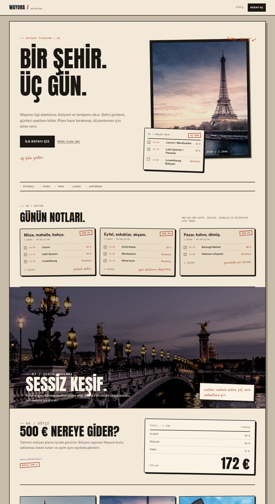

# Wayora: AI Destekli Seyahat Planlama

Tercihlerine, bütçene ve süreye göre **gün gün gezi planı** üreten web uygulaması.
İstinye Üniversitesi **JOB-191** ders projesi (GrepThink).

> Durum: **MVP çalışıyor.** Kayıt/giriş, tercihler, gezi CRUD, AI plan üretimi, aktivite
> düzenleme ve bütçe özeti uçtan uca hazır. Uygulama **API anahtarı olmadan** da çalışır.



## Özellikler

- **Hesap:** e-posta/şifre ile kayıt, JWT + httpOnly cookie oturumu, çıkış.
- **Tercihler:** ilgi alanları, bütçe seviyesi, seyahat tarzı ve tempo.
- **Geziler:** destinasyon, tarih, bütçe ile gezi oluşturma; listeleme, silme.
- **AI plan:** gün gün, saatli ve maliyetli plan; ilgi alanlarına göre sıralama.
- **Doğrulama:** LLM çıktısı zod ile doğrulanır, uydurma mekânlar filtrelenir.
- **Fallback:** sağlayıcı hatasında deterministik offline üretici devreye girer.
- **Düzenleme:** güne elle aktivite ekleme, aktivite silme.
- **Bütçe:** tahmini toplam, kalan bütçe ve aşım uyarısı.
- **Tasarım:** responsive, koyu tema, erişilebilir formlar ve odak durumları.

## Hızlı başlangıç

Gerekenler: **Node.js 22+** (önerilen 24, bkz. `.nvmrc`). Veritabanı için hesap veya Docker
gerekmez: Prisma'nın yerel PostgreSQL sunucusu (`prisma dev`) bilgisayarınızda çalışır.

```bash
git clone https://github.com/mehmeteminakkaya/wayora.git
cd wayora
npm run setup                     # bağımlılıklar + api/.env + yerel Postgres + tablolar
npm run dev                       # veritabanı + api → :4000 + web → :5180
```

Tarayıcıda [http://localhost:5180](http://localhost:5180) açılır.

### Demo akışı

1. **Ücretsiz başla** → kayıt ol.
2. Tercihleri seç (ör. Müze + Yemek, orta bütçe).
3. **Yeni gezi**: Paris, 3 gün, 500 EUR.
4. **AI ile plan oluştur** → gün gün planı, maliyet özetini ve ipuçlarını gör.
5. Bir güne aktivite ekle, bir aktiviteyi sil.

## AI sağlayıcıları

Varsayılan `offline` moddur: API anahtarı gerekmez, sonuç deterministiktir, maliyeti sıfırdır.

```bash
# api/.env
LLM_PROVIDER=offline            # offline | gemini | openai
# GEMINI_API_KEY=...
# OPENAI_API_KEY=...
LLM_MODEL_SMART=gemini-2.5-pro  # plan (hard task)
LLM_MODEL_FAST=gemini-2.0-flash # kısa görevler (easy task)
LLM_TIMEOUT_MS=20000
AI_DAILY_LIMIT=10
```

`gemini`/`openai` seçildiğinde ilgili anahtar zorunludur (`config.ts` doğrular). Sağlayıcı
hatasında plan offline üreticiyle hazırlanır ve yanıtta `meta.fallback = true` döner.

## Komutlar (kök dizinden)

| Komut | Ne yapar |
| :--- | :--- |
| `npm run dev` | Veritabanı + API + web'i birlikte başlatır |
| `npm run lint` | oxlint |
| `npm run typecheck` | TypeScript kontrolü |
| `npm test` | Vitest (api: Supertest, web: Testing Library) |
| `npm run build` | Üretim derlemesi |
| `npm run db:migrate -w api` | Şema değişikliğinden migration üretir ve uygular |
| `npm run db:studio -w api` | Prisma Studio |
| `npm run db:stop -w api` | Yerel veritabanını durdurur (veriler kalır) |
| `npm run hooks:install` | `pre-commit` hook'unu etkinleştirir (lint + typecheck) |

## Mimari

```text
web/   React 19 + TypeScript + Vite + React Router
api/   Express 5 + TypeScript + Prisma 7 + PostgreSQL
       ├── routes/     auth, preferences, trips, activities, places, health
       ├── services/   itinerary (offline + Gemini + OpenAI + fallback)
       └── data/       anahtarsız şehir kataloğu
docs/  ürün, mimari, sprint ve agent belgeleri
mcp/   Wayora Context MCP sunucusu
```

Ayrıntı: [docs/ARCHITECTURE.md](docs/ARCHITECTURE.md) · API sözleşmesi:
[docs/specs/001-mvp/plan.md](docs/specs/001-mvp/plan.md)

## Dersin projeye yansıması

AI-Augmented Software Engineering dersindeki pratikler yalnızca dokümanda değil, çalışan
artefaktlarda:

| Ders konusu | Wayora'daki karşılığı |
| :--- | :--- |
| Spec-driven development | [docs/specs/001-mvp/](docs/specs/001-mvp/): constitution, spec, plan, tasks |
| Agentic codebase structure | [AGENTS.md](AGENTS.md), [api/AGENTS.md](api/AGENTS.md), [web/AGENTS.md](web/AGENTS.md), [api/src/services/AGENTS.md](api/src/services/AGENTS.md) |
| Skills / reusable workflows | [.agents/skills/](.agents/skills/): feature, review, security |
| Context management + MCP | [docs/CONTEXT.md](docs/CONTEXT.md), [mcp/wayora-context/](mcp/wayora-context/) |
| Code review & testing | [docs/AI_REVIEW.md](docs/AI_REVIEW.md), [.coderabbit.yaml](.coderabbit.yaml), PR şablonu, CI |
| Agent orchestration | [docs/ORCHESTRATION.md](docs/ORCHESTRATION.md), [scripts/new-worktree.mjs](scripts/new-worktree.mjs) |
| Security | [docs/SECURITY.md](docs/SECURITY.md), rate limit, prompt injection testleri, gitleaks/CodeQL/Semgrep |
| Software factory | [docs/SOFTWARE_FACTORY.md](docs/SOFTWARE_FACTORY.md) |
| AI-native teams + gateway | [docs/AI_NATIVE_TEAM.md](docs/AI_NATIVE_TEAM.md): model routing, fallback, maliyet |

## Tasarım

Tasarım yönü **WAYORA / ROTASYON**: analog seyahat defteri. Putty zemin, krem kağıt, ağır mürekkep tipografisi, gerçek şehir fotoğrafları, damgalar ve el yazısı notlar. Anton + Public Sans + IBM Plex Mono + Caveat. Gradient, glassmorphism, badge, emoji, hazır ikon kütüphanesi ve üç ikonlu kutu yok. Ayrıntı: [docs/DESIGN_SYSTEM.md](docs/DESIGN_SYSTEM.md). Fotoğraflar: Unsplash (demo).

## Teslim dosyaları

Dönem projesi için hazırlanan Word ve sunum paketi:

- [Wayora-Proje-Raporu.docx](docs/Wayora-Proje-Raporu.docx): detaylı proje raporu
- [Wayora-Proje-Yonetimi.docx](docs/Wayora-Proje-Yonetimi.docx): proje yönetimi planı
- [Wayora-User-Stories.docx](docs/Wayora-User-Stories.docx): 20 user story + kabul kriterleri
- [Wayora-Sunum.pptx](docs/Wayora-Sunum.pptx): 14 slaytlık sunum
- [Teslim özeti](docs/TESLIMLER.md)
- [Audit raporu](docs/audit/AUDIT_REPORT.md)
- [1000 kişilik master audit promptu](docs/MASTER_AUDIT_PROMPT.md)

## Test ve guardrail'ler

- **32 API testi:** auth, tercihler, health, hata yolları, offline plan, halüsinasyon filtresi,
  prompt sınırı, fallback ve Gemini entegrasyonu.
- **4 web testi:** landing, login, korumalı yönlendirme, boş gezi durumu.
- CI: lint + typecheck + test + build + `npm audit`.
- Güvenlik: gitleaks, CodeQL, Semgrep, Dependabot.
- AI review: CodeRabbit yapılandırması + insan onayı.

```bash
npm run lint && npm run typecheck && npm test && npm run build
```

## Klasörler

```text
web/                    React + Vite + TypeScript
api/                    Express + TypeScript + Prisma
  prisma/               şema + migration'lar
  src/services/         AI plan üretimi
docs/                   ürün, mimari, sprint, güvenlik, agent belgeleri
  specs/001-mvp/        SDD artefaktları
.agents/skills/         tekrar kullanılabilir agent iş akışları
mcp/wayora-context/     MCP sunucusu
scripts/                worktree yardımcısı
```

## Ekip

Bayram Selim Yılmaz (PO) · Mehmet Emin Akkaya (Scrum Master) · Ezgi Turan · Aykut Kayra Akkuş ·
Berfin Aksoy

## Katkı

Akış: `feat/W-xx-kisa-ad` dalı → PR → 1 onay + yeşil CI → `main`. Ayrıntı:
[docs/TEAM.md](docs/TEAM.md). Agent'larla çalışırken [AGENTS.md](AGENTS.md) ve
[docs/ORCHESTRATION.md](docs/ORCHESTRATION.md) izlenir.

> Not: Bu repo, ders materyali reposundan (`scottyUX/AI-Augmented-Software-Engineering`)
> bağımsızdır. O repoya PR/commit gönderilmez.
