# Wayora

**Şehri hisset, gününü şekillendir.**

Wayora, ilgi alanlarına, bütçene ve tempona göre **gün gün, saat saat seyahat planı**
üreten mobil öncelikli bir şehir rehberi ve planlama uygulamasıdır. Kullanıcı yalnızca bir
şehir seçmez; deneyimleri keşfeder, rotasına ekler, tarih ve bütçesini belirler ve oluşan
planı gün gün düzenler.

İstinye Üniversitesi **JOB-191** ders projesi (GrepThink ekibi).

> **Durum:** V2 çalışıyor. 14 şehir ve 140 deneyimlik katalog, keşif, deneyim seçimi,
> kimlik doğrulama, onboarding, rota oluşturma, gün planlama, bütçe özeti ve profil
> akışları uçtan uca hazır. Uygulama **API anahtarı olmadan** çalışır.

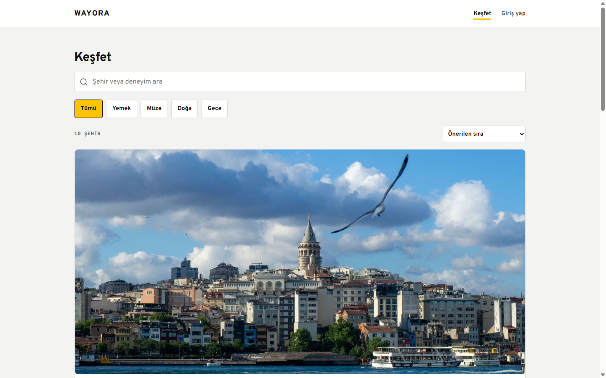

## İçindekiler

- [Ne yapar?](#ne-yapar)
- [Öne çıkanlar](#öne-çıkanlar)
- [Ekranlar](#ekranlar)
- [Hızlı başlangıç](#hızlı-başlangıç)
- [Demo akışı](#demo-akışı)
- [Repo yapısı](#repo-yapısı)
- [Mimari](#mimari)
- [AI plan üretimi](#ai-plan-üretimi)
- [Test ve doğrulama](#test-ve-doğrulama)
- [Güvenlik](#güvenlik)
- [Ders uyumu](#ders-uyumu)
- [Bilinen sınırlar](#bilinen-sınırlar)
- [Yol haritası](#yol-haritası)
- [Dokümanlar](#dokümanlar)
- [Komutlar](#komutlar)
- [Ekip](#ekip)
- [Katkı](#katkı)

## Ne yapar?

Wayora üç temel duygu üzerine kurulur:

- **Keşfederken merak:** Fotoğraflı şehir kartları, kategoriler ve kısa karar bilgileri.
- **Planlarken kontrol:** Seçilen durakların anlık özeti, tarih/bütçe adımları ve gün gün plan.
- **Tamamladığında rahatlık:** Sabit eylem çubuğu, kısa onay metinleri ve düzenlenebilir rota.

Mevcut sürümde kullanıcı:

1. **Keşfet** ekranında şehir veya deneyim arar; kategori ve sıralama filtrelerini kullanır.
2. Şehir rehberinde deneyimleri süre, tahmini fiyat ve katalog puanıyla karşılaştırır.
3. Beğendiği deneyimleri seçer; sabit özetten seçimlerini görür ve kaldırır.
4. Seçimlerini yeni rota akışına taşır; gerekirse giriş yapar ve kaldığı yerden devam eder.
5. Tarih, toplam bütçe ve tempo bilgisini belirler.
6. Oluşan rotayı gün şeridinde gezer; durak ekler, siler ve sıralamayı değiştirir.
7. Rota detayında Ticketmaster etkinliklerini ve Duffel test uçuşlarını görür.
8. Tercihlerini profilden günceller; rotalarını yaklaşan, taslak ve geçmiş olarak görür.
9. **Yol Arkadaşları** ekranında aynı şehir ve tarihlerdeki gezginlerle eşleşir; karşılıklı
   kabulden sonra güvenli biçimde mesajlaşır, engeller veya bildirir.

## Öne çıkanlar

### Ürün akışı

- 14 şehir ve 140 lisanslı deneyimden oluşan sürümlenmiş katalog.
- Şehir/deneyim arama, kategori filtresi, sıralama ve boş sonuç durumu.
- Deneyim detayında süre, tahmini kişi başı maliyet, katalog puanı, pratik bilgiler, harita
  ve OpenStreetMap bağlantısı.
- Seçim özeti URL'de taşınır; giriş veya yeni kayıt sonrası seçimler kaybolmaz.
- 3 adımlı yeni rota sihirbazı: şehir → tarih → bütçe/tempo.
- Rota detayında gün sekmeleri, gün panosu, dikey rota çizgisi, liste/harita görünümü,
  durak ekleme/silme ve sürükleme, klavye ve butonlarla sıralama.
- Şehir sayfasında ve rota detayında Ticketmaster ile canlı etkinlik keşfi; rota detayında
  Duffel test token'ı varsa uçuş fikri.
- Rotalarım ekranında yaklaşan, taslak ve geçmiş rotalar; silme onayı.
- Profilde kayıtlı tercihleri görüntüleme ve düzenleme.
- **Yol Arkadaşları:** aynı şehir ve tarih kesişimine göre açıklanabilir eşleşme, karşılıklı
  bağlantı isteği, kabul sonrası sohbet, engelleme ve bildirim. Ev sahipliği yalnızca niyet
  bilgisidir; adres, rezervasyon veya ödeme yoktur.
- **Canlı keşif:** Ticketmaster Discovery ile şehir sayfasında ve rota detayında
  şehir etkinlikleri; Duffel test token'ı varsa uçuş fikri. Anahtar yoksa bölüm uydurma
  veri üretmez, yapılandırma notu gösterir. Otel/rezervasyon satışı bu sürümde yoktur.
- **Wayora Agent:** DeepSeek destekli sohbet; katalog araması, site içi sayfa açma, etkinlik
  ve uçuş fikri araçları. Yalnızca giriş yapmış kullanıcıya açılır, saatte 60 mesajla
  sınırlıdır ve uçuş test verisini açıkça etiketler.

### Dayanıklılık

- LLM anahtarı yoksa deterministik **offline** plan üreticisi devreye girer.
- LLM yanıtı `zod` ile doğrulanır; katalogda olmayan yer kimlikleri atılır.
- API hata biçimi her yerde aynıdır: `{ "error": { "code": "...", "message": "..." } }`.
- Yükleme, boş, hata, tekrar dene, işlem sürüyor ve başarı durumları ayrı ayrı tasarlanmıştır.
- Optimistik seçim ve sıralama işlemlerinde tekrar dokunuşlar kuyruk oluşturmaz.
- Keşfet'te arama, filtre, sıralama ve scroll konumu geri dönüşte korunur.
- `prefers-reduced-motion` tercihinde tüm işlevler animasyonsuz kullanılabilir.

### Tasarım

- V2 kimliği: krem zemin, beyaz yüzey, güçlü Overpass tipografisi ve kontrollü sarı vurgu.
- Mobilde 5 sekmeli alt navigasyon: **Keşfet, Rotalarım, Yol, Planla, Profil**.
- 320, 375, 390 ve 430 px genişliklerde yatay taşma ve kesilen ana eylem kontrolü.
- 44 px dokunma hedefleri, görünür klavye odağı, dialog semantiği ve etiketli formlar.
- Gerçek lisanslı fotoğraflar; kategori/şehir görseli olduğu açıkça belirtilir.

## Ekranlar

Ekran görüntüleri yerel geliştirme ortamından alınmıştır. Tam boy görseller
[`docs/audit/`](docs/audit/) altındadır.

| Landing | Keşfet | Şehir |
| :---: | :---: | :---: |
| 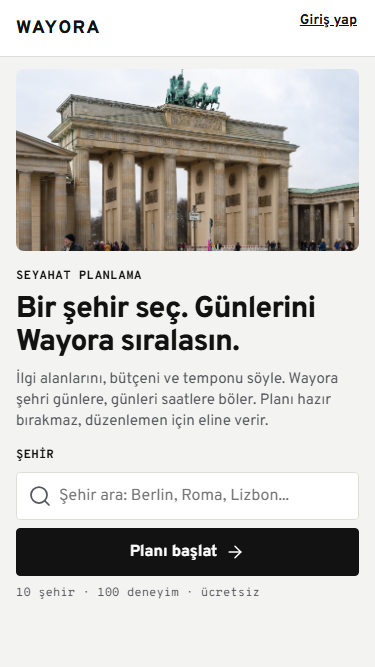 | 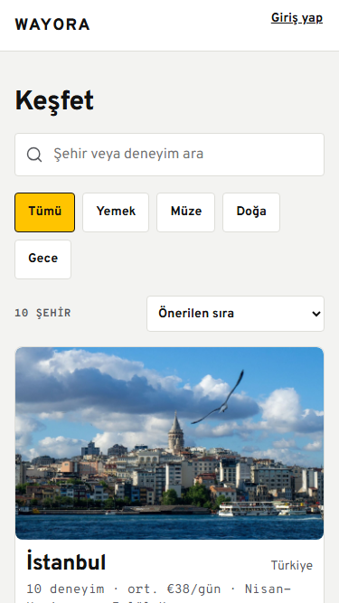 | 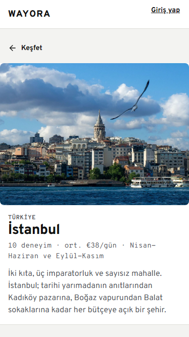 |

| Deneyim | Seçim özeti | Yeni rota |
| :---: | :---: | :---: |
| 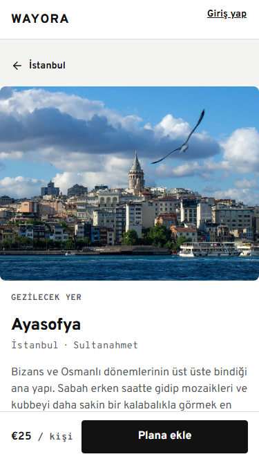 | 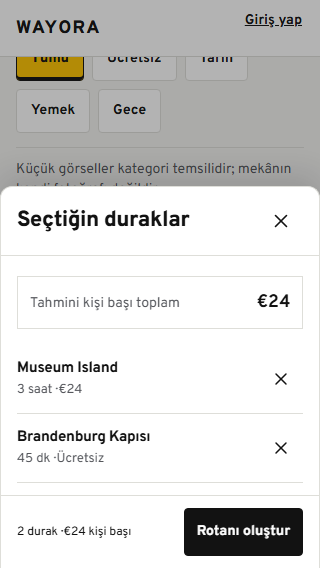 | 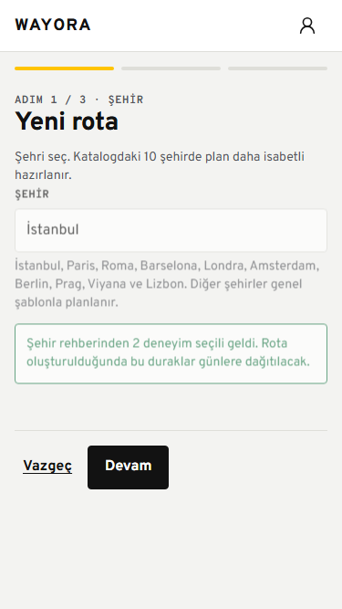 |

| Rota detayı | Rotalarım | Profil |
| :---: | :---: | :---: |
| 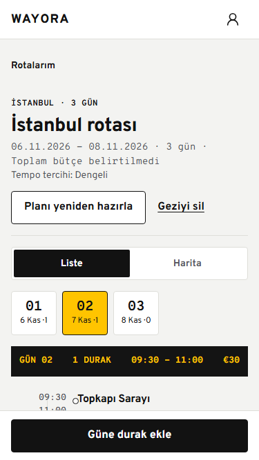 | 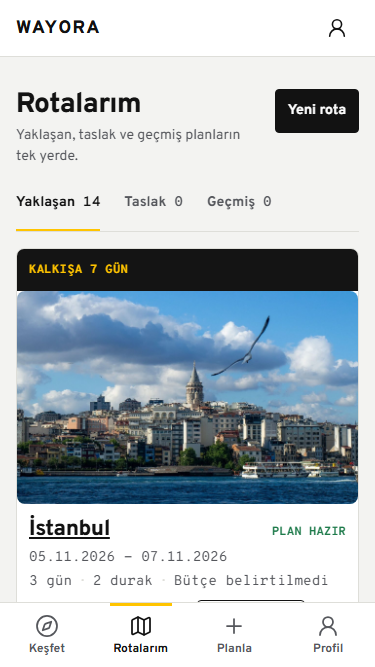 | 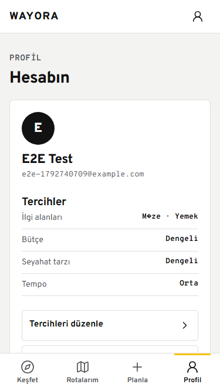 |

| Onboarding | Giriş |
| :---: | :---: |
| 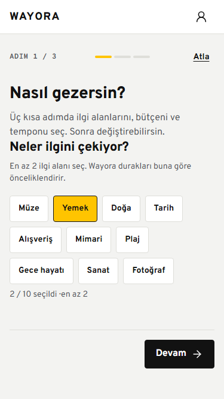 | 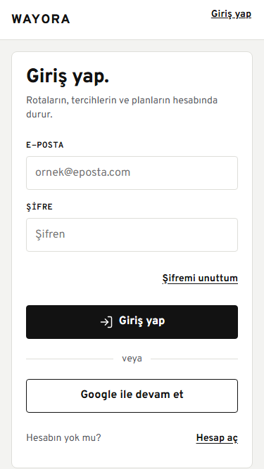 |

> Not: Ekran görüntüleri gerçek API ve yerel PostgreSQL üzerinde çalışan uygulamadan alınmıştır.
> Fiziksel cihaz testi yapılmamıştır.

## Hızlı başlangıç

### Gerekenler

- **Node.js 22.22.2+ veya 24.15+** (önerilen 24; bkz. `.nvmrc`)
- npm
- Docker veya harici PostgreSQL hesabı **gerekmez**: Prisma'nın yerel PostgreSQL sunucusu
  `prisma dev` ile bilgisayarında çalışır.

> **Node sürümün eskiyse:** `npm install` / `npm run setup` en başta `EBADENGINE` ile durur
> (`.npmrc` içinde `engine-strict=true`). Alt sınırı web testlerini çalıştıran `jsdom` belirliyor;
> `jsdom@30`, `^22.22.2 || ^24.15.0 || >=26` istiyor. Node'u güncelle; sürüm yöneticisi
> kullanıyorsan proje klasöründe `nvm use` ya da `fnm use` `.nvmrc`'deki 24'ü seçer.

### Kurulum

```bash
git clone https://github.com/mehmeteminakkaya/wayora.git
cd wayora

npm run setup
# bağımlılıklar + api/.env + yerel PostgreSQL + migration'lar

npm run dev
# veritabanı + API :4000 + web :5180
# API açılışta 14 şehir / 140 deneyim kataloğunu idempotent seed eder
```

Tarayıcıda [http://localhost:5180](http://localhost:5180) açılır.

Sağlık kontrolü:

```bash
curl http://localhost:4000/api/health
# {"status":"ok","db":"ok"}
```

Ortam değişkenleri, opsiyonel sağlayıcılar (DeepSeek, Ticketmaster, Duffel, Mapbox), demo
verisi ve canlı ortam: [`docs/engineering/SETUP.md`](docs/engineering/SETUP.md).

**Canlı ortam:** https://wayora-ten.vercel.app · sağlık: https://wayora-ten.vercel.app/api/health

## Demo akışı

1. **Keşfet** ekranına git; arama alanına `İstanbul` yaz.
2. Şehir kartını aç; iki deneyim seç.
3. Alt özetten seçimleri kontrol et; **Rotanı oluştur**.
4. Giriş yap veya yeni hesap aç. Giriş sonrası seçimler ve dönüş adresi korunur.
5. Tarih aralığını ve toplam bütçeyi belirle; rotayı oluştur.
6. Rota detayında gün şeridini değiştir; durak ekle, sil veya sırala.
7. **Rotalarım** ekranında rotayı yeniden aç; **Profil** ekranında tercihleri güncelle.

Yerel veritabanını sıfırlamadan tekrar denemek için yeni bir e-posta ile kayıt olabilirsin.

Yol Arkadaşları için 75 örnek gezgin: `npm run demo:seed -w api` (ayrıntı
[`SETUP.md`](docs/engineering/SETUP.md#yol-arkadaşları-demo-verisi)).

## Repo yapısı

```text
wayora/
├── web/                 React 19 + Vite arayüzü
├── api/                 Express 5 + Prisma API, LLM servisleri
├── mcp/wayora-context/  Wayora Context MCP sunucusu (geliştirici aracı)
├── scripts/
│   ├── e2e/             tarayıcı ve API uçtan uca akışları
│   ├── audit/           UI denetimleri, ürün laboratuvarı simülasyonları
│   ├── capture/         ekran görüntüsü üretimi
│   ├── docs/            rapor/sunum üreticileri (Python)
│   └── dev/             db watchdog, worktree yardımcıları
├── docs/
│   ├── product/         kapsam, yol haritası, backlog, ekip, katalog
│   ├── engineering/     mimari, API, frontend, kurulum, test, güvenlik, tasarım
│   ├── agentic/         bağlam, orkestrasyon, AI review, software factory, handoff
│   ├── course/          ders izlenebilirliği ve teslim listesi
│   ├── specs/           spec-driven development artefaktları (001–003)
│   ├── audit/           denetim raporları (reports/) ve ekran görüntüleri (screenshots/)
│   ├── deliverables/    hoca teslimi, raporlar (docx/pdf), sunumlar (pptx)
│   └── assets/          README ve belge görselleri
├── .agents/skills/      agent skill'leri (feature, review, security)
├── .github/             CI, CodeQL, Semgrep, gitleaks, PR şablonu, CODEOWNERS
└── AGENTS.md            her agent için her zaman yüklü bağlam (+ api/, web/ alt kuralları)
```

Doküman haritası: [`docs/README.md`](docs/README.md).

## Mimari

```text
┌────────────────────────────┐        REST/JSON        ┌─────────────────────────────┐
│ web/                       │ ──────────────────────▶ │ api/                        │
│ React 19 · TypeScript      │ ◀────────────────────── │ Express 5 · TypeScript      │
│ Vite · React Router        │      HttpOnly cookie    │ zod · helmet · rate limit   │
│ saf CSS · Lucide           │                         └───────────┬─────────────────┘
└─────────────┬──────────────┘                                     │
              │ Mapbox GL (token) / OSM yedeği                     │ Prisma 7
              ▼                                                    ▼
       Harita · stil seçici · marker                      PostgreSQL
                                                          (yerel prisma dev)
                                                                   │
                                                                   ▼
                                                     ┌──────────────────────────────────┐
                                                     │ itinerary service                │
                                                     │ offline · Gemini · OpenAI        │
                                                     │ DeepSeek · doğrulama + fallback │
                                                     └──────────────────────────────────┘
```

### Kararlar

- **Monorepo:** npm workspaces (`web/`, `api/`); ek araç gerekmez.
- **Frontend:** React 19 + Vite + React Router; global state kütüphanesi yok.
- **Backend:** Express 5 + zod; tüm hata yanıtları ortak biçimde.
- **Veritabanı:** Prisma 7 + `@prisma/adapter-pg`; yerelde `prisma dev`.
- **Auth:** JWT, HttpOnly cookie; token tarayıcıda localStorage'a yazılmaz.
- **Harita:** Mapbox GL (`VITE_MAPBOX_TOKEN` varsa) — Standard stil, 3B bina, uydu ve karanlık
  seçenekleri; token veya WebGL yoksa OpenStreetMap bağlantılı okunur yedek gösterilir.
- **Canlı keşif:** Ticketmaster Discovery ve Duffel test token'ı opsiyonel; anahtar yoksa
  uygulama offline çalışır ve sahte veri üretmez.
- **Tasarım:** saf CSS + merkezi tokenlar; Tailwind/UI kit yok.
- **AI:** offline varsayılan; Gemini/OpenAI/DeepSeek adaptörleri opsiyonel.

Ayrıntı: [`ARCHITECTURE.md`](docs/engineering/ARCHITECTURE.md) ·
[`API.md`](docs/engineering/API.md) · [`FRONTEND.md`](docs/engineering/FRONTEND.md) ·
[`DESIGN_SYSTEM.md`](docs/engineering/DESIGN_SYSTEM.md) ·
[`CITY_CATALOG.md`](docs/product/CITY_CATALOG.md).

## AI plan üretimi

```text
Kullanıcı girdisi
   │
   ▼
Aday deneyimler (şehir kataloğu)
   │
   ├── LLM_PROVIDER=offline  → deterministik offline üretici
   ├── LLM_PROVIDER=gemini   → Gemini
   ├── LLM_PROVIDER=openai   → OpenAI
   └── LLM_PROVIDER=deepseek → DeepSeek
   │
   ▼
zod doğrulaması + aday kimlik filtresi
   │
   ├── başarılı → TripDay / Activity kaydı
   └── hata     → offline fallback (meta.fallback = true)
```

- `offline` varsayılan ve ücretsizdir; demo/test için deterministiktir.
- DeepSeek Search & Fetch API ile isteğe bağlı canlı web araştırması yapılabilir.
- LLM'e yalnızca aday deneyimler verilir; olmayan yer kimlikleri atılır.
- Aynı katalog yeri aynı rotada tekrar ettirilmez.
- Toplam maliyet backend'de hesaplanır; bütçe aşımı UI'da uyarı olarak gösterilir.
- Üretim uzun sürebileceği için arayüzde sahte yüzde yerine gerçek aşama metni gösterilir.
- Sağlayıcı hatasında kullanıcı girdileri korunur; rota kaydı oluştuysa mevcut kayda dönüş sunulur.

## Test ve doğrulama

```bash
npm run lint && npm run typecheck && npm test && npm run build
```

| Kontrol | Sonuç (18 Kasım 2026) |
| :--- | ---: |
| API testleri | 79 / 79 |
| Web testleri | 10 / 10 |
| Lint | geçti |
| Web production build | geçti |

Tarayıcı E2E ve mobil denetim script'leri `scripts/e2e/` ve `scripts/audit/` altındadır;
kanıtlar [`docs/audit/`](docs/audit/) içinde tutulur. Fiziksel cihaz testi yapılmamıştır.
Ayrıntı: [`docs/engineering/TESTING.md`](docs/engineering/TESTING.md).

## Güvenlik

- JWT HttpOnly cookie; token localStorage'a yazılmaz.
- Şifreler bcryptjs ile hash'lenir.
- Production'da güçlü `JWT_SECRET` ve `COOKIE_SECURE=true` zorunludur.
- Helmet, CORS allowlist, JSON gövde limiti ve rate limit.
- Tüm kullanıcı kaynakları `userId` ile filtrelenir; başkasının kaynağı 404 döner.
- LLM çıktısı zod ile doğrulanır; prompt injection ve halüsinasyon filtreleri.
- Gitleaks, CodeQL, Semgrep, Dependabot ve CodeRabbit yapılandırması repoda.
- `.env` gitignore'dadır; yalnızca `.env.example` güncellenir.

Ayrıntı: [`docs/engineering/SECURITY.md`](docs/engineering/SECURITY.md).

## Ders uyumu

Proje, [`scottyUX/Software-engineering-in-the-age-of-ai`](https://github.com/scottyUX/Software-engineering-in-the-age-of-ai)
dersindeki pratikleri uygular. Her dersin repodaki karşılığı:

| Ders | Konu | Wayora'daki karşılığı |
| :--- | :--- | :--- |
| 1 | Setup Environments | `npm run setup`, `.nvmrc`, `.editorconfig`, `.githooks/` |
| 2 | Specs-Driven Development | [`docs/specs/`](docs/specs/) (constitution, spec, plan, tasks) |
| 3 | Anatomy of Coding Agents | Wayora Agent araç döngüsü: `api/src/services/agent.ts` |
| 4 | Agentic Codebase Structure | `AGENTS.md` hiyerarşisi, [`.agents/skills/`](.agents/skills/), `.githooks/` |
| 5 | Advanced Context Management | [`mcp/wayora-context/`](mcp/wayora-context/), [`CONTEXT.md`](docs/agentic/CONTEXT.md), [`PROGRESS.md`](docs/agentic/PROGRESS.md) |
| 6 | Agentic Code Review and Testing | CI, `.coderabbit.yaml`, [`AI_REVIEW.md`](docs/agentic/AI_REVIEW.md), [`TESTING.md`](docs/engineering/TESTING.md) |
| 7 | Agent Orchestration | [`ORCHESTRATION.md`](docs/agentic/ORCHESTRATION.md), `scripts/dev/new-worktree.mjs` |
| 8 | Security in the Age of AI | CodeQL, Semgrep, gitleaks, Dependabot, [`SECURITY.md`](docs/engineering/SECURITY.md) |
| 9 | Software Factory | [`SOFTWARE_FACTORY.md`](docs/agentic/SOFTWARE_FACTORY.md) |
| 10 | AI-Native Engineering Teams | [`AI_NATIVE_TEAM.md`](docs/agentic/AI_NATIVE_TEAM.md), `LLM_PROVIDER` yönlendirmesi + offline fallback |

Kavram düzeyinde durum, kanıt ve açık boşluklar:
[`docs/course/COURSE_TRACEABILITY.md`](docs/course/COURSE_TRACEABILITY.md).

## Bilinen sınırlar

Bu sürümde bilinçli olarak kapsam dışında bırakılanlar:

- Google OAuth ve gerçek şifre sıfırlama sağlayıcısı.
- Canlı rezervasyon, bilet satın alma ve ödeme.
- Canlı açık/kapalı durumu, kesin fiyat veya transfer süresi.
- Ticketmaster bilet satın alma; yalnızca Discovery keşfi bağlı, Partner/Commerce erişimi yok.
- Duffel canlı uçuş/otel satışı; yalnızca test token'ı ile uçuş fikri gösterilir.
- Otel arama; Booking.com Demand API partner başvurusu gerektirir.
- Kullanıcı yorumu/puanı; katalog puanı editoryal veridir.
- Canlı trafik, toplu taşıma ve rota geometrisi çizimi; harita katalog koordinatlarını
  marker olarak gösterir, yol tarifi üretmez.
- PWA/offline harita.
- Fiziksel iOS/Android cihaz testi.
- Her deneyim için tekil lisanslı fotoğraf; bazı küçük görseller kategori temsilidir.

Bu maddeler tamamlanmış gibi gösterilmez; arayüz gerekli yerlerde fallback ve açıklama sunar.

## Yol haritası

- [ ] Google OAuth ve e-posta doğrulamalı şifre sıfırlama.
- [ ] Deneyim başına tekil lisanslı görsel seti.
- [x] Mapbox GL ile katalog marker'ları, stil seçici ve WebGL yedeği.
- [ ] Rota geometrisi ve adım adım yol tarifi.
- [ ] Canlı fiyat/rezervasyon sağlayıcısı adaptörü.
- [ ] PWA ve çevrimdışı rota görüntüleme.
- [x] Bulut deploy ve üretim veritabanı (Vercel + Neon).
- [ ] Fiziksel cihaz ve gerçek kullanıcı testi.

## Dokümanlar

Tüm belgelerin haritası [`docs/README.md`](docs/README.md) içindedir. En sık gerekenler:

| Konu | Dosya |
| :--- | :--- |
| Ürün kapsamı | [`PROJECT_OVERVIEW.md`](docs/product/PROJECT_OVERVIEW.md), [`specs/001-mvp/spec.md`](docs/specs/001-mvp/spec.md) |
| Mimari ve API | [`ARCHITECTURE.md`](docs/engineering/ARCHITECTURE.md), [`API.md`](docs/engineering/API.md) |
| Kurulum ve deploy | [`SETUP.md`](docs/engineering/SETUP.md) |
| Güvenlik | [`SECURITY.md`](docs/engineering/SECURITY.md) |
| Agent iş akışı | [`AGENTS.md`](AGENTS.md), [`ORCHESTRATION.md`](docs/agentic/ORCHESTRATION.md) |
| Sprint/backlog | [`ROADMAP.md`](docs/product/ROADMAP.md), [`BACKLOG.md`](docs/product/BACKLOG.md) |
| Ders teslimleri | [`TESLIMLER.md`](docs/course/TESLIMLER.md), [`deliverables/`](docs/deliverables/) |

## Komutlar

### Kök dizin

| Komut | Ne yapar |
| :--- | :--- |
| `npm run setup` | Bağımlılıklar, `api/.env`, yerel PostgreSQL, migration ve seed |
| `npm run dev` | Veritabanı + API + web |
| `npm run lint` | oxlint (tüm workspace) |
| `npm run typecheck` | TypeScript kontrolü |
| `npm test` | Vitest (API + web) |
| `npm run build` | Üretim derlemesi |
| `npm run hooks:install` | pre-commit hook (lint + typecheck) |

API ve web çalışma alanı komutları: [`SETUP.md`](docs/engineering/SETUP.md#çalışma-alanı-komutları).

## Ekip

| Kişi | Rol |
| :--- | :--- |
| Bayram Selim Yılmaz | Product Owner · Frontend Lead |
| Mehmet Emin Akkaya | Scrum Master · Backend + AI Lead |
| Ezgi Turan | Designer |
| Aykut Kayra Akkuş | Database |
| Berfin Aksoy | Frontend + Test |

## Katkı

1. `feat/W-xx-kisa-ad` biçiminde dal aç.
2. İlgili spec/task ve `AGENTS.md` dosyalarını oku.
3. Davranış değişikliği için önce test yaz.
4. `npm run lint && npm run typecheck && npm test && npm run build` çalıştır.
5. PR aç; 1 onay + yeşil CI ile `main`e al.

Agent'larla çalışırken [`AGENTS.md`](AGENTS.md), [`docs/agentic/ORCHESTRATION.md`](docs/agentic/ORCHESTRATION.md)
ve [`.agents/skills/`](.agents/skills/) izlenir.

## Lisans

Bu repo bir ders projesidir. Üçüncü taraf fotoğrafların lisansları
[`docs/product/PHOTO_CREDITS.md`](docs/product/PHOTO_CREDITS.md) içinde belirtilmiştir; kod için ayrı bir
açık kaynak lisansı tanımlanmamıştır.

---

> Bu repo, ders materyali reposundan (`scottyUX/Software-engineering-in-the-age-of-ai`)
> bağımsızdır. O repoya PR/commit gönderilmez.
