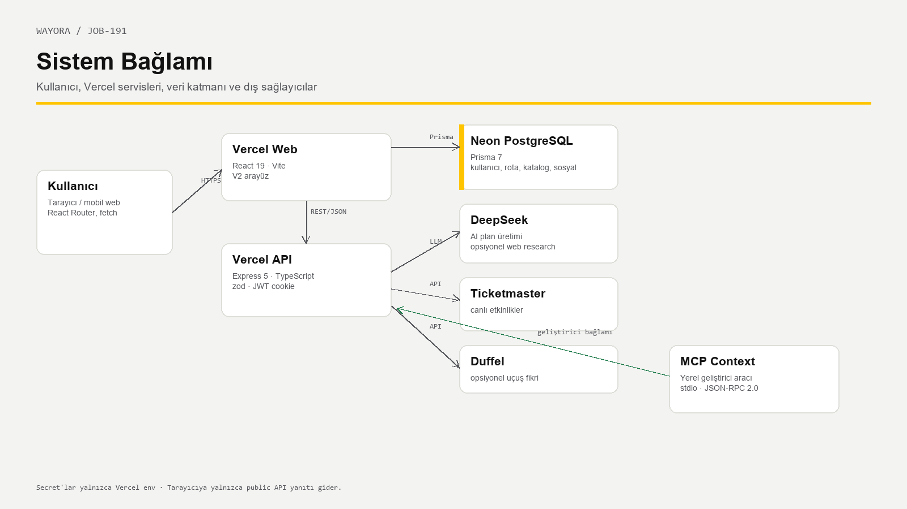
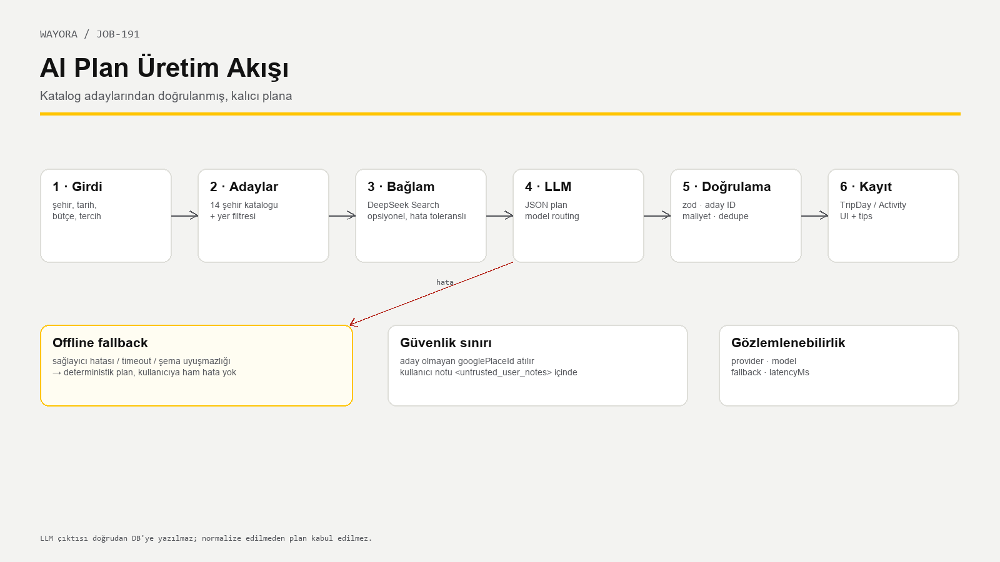
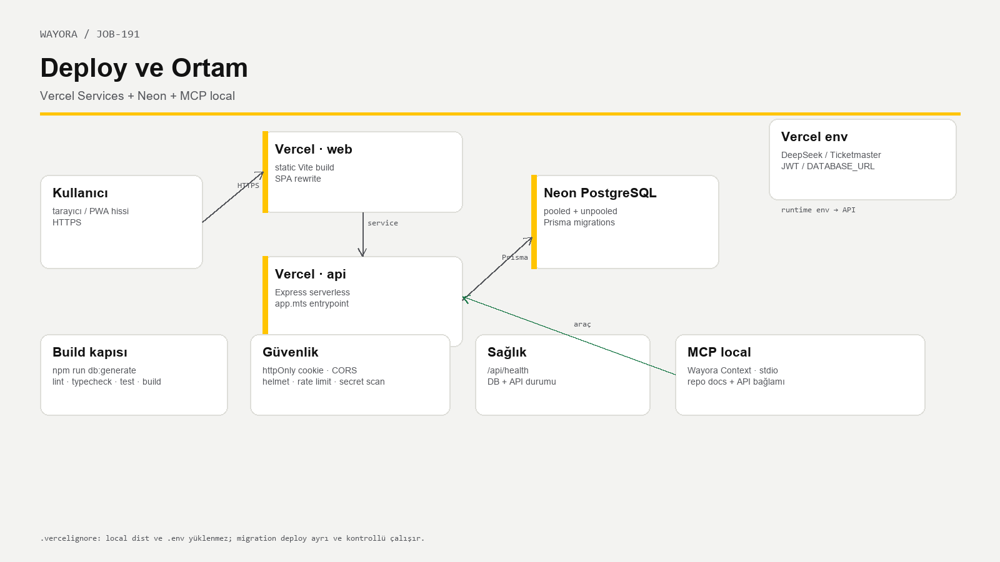

# Mimari Hedef

Wayora, tek bir sunucu uygulaması değil; birbirinden ayrılmış ama birlikte çalışan
dört katmandan oluşur:

1. **Web:** React 19 + Vite + React Router; V2 arayüzü.
2. **API:** Express 5 + TypeScript; auth, rota, AI, keşif ve sosyal iş kuralları.
3. **Veri:** Neon PostgreSQL + Prisma 7; katalog, rota, kullanıcı ve sosyal tablolar.
4. **Dış servisler:** DeepSeek, Ticketmaster, opsiyonel Duffel ve yerel MCP bağlamı.

Temel kural: **tarayıcı hiçbir gizli anahtarı görmez.** LLM, Ticketmaster ve veritabanı
erişimi yalnızca API katmanındadır.

# Bileşenler

| Bileşen | Teknoloji | Sorumluluk | Sınır |
| :--- | :--- | :--- | :--- |
| Web | React 19, Vite, React Router | Sayfalar, formlar, mobil deneyim | Secret yok; yalnızca API |
| API | Express 5, TypeScript, zod | Auth, sahiplik, AI, keşif, sosyal | Serverless Vercel |
| Veri | PostgreSQL, Prisma 7 | Kullanıcı, rota, katalog, sosyal | Migration ile yönetilir |
| AI | DeepSeek + offline fallback | Plan üretimi, web research | Timeout/şema hatasında fallback |
| Canlı keşif | Ticketmaster, Duffel | Etkinlik ve uçuş fikri | Anahtar yoksa dürüst boş durum |
| MCP | Yerel Node sunucusu | Geliştiriciye repo/API bağlamı | Yalnızca local, stdio |
| Deploy | Vercel Services + Neon | Web/API/DB çalıştırma | `.vercelignore` ile temiz paket |

# İstek Akışı

1. Tarayıcı `credentials: include` ile API’ye gider.
2. Express; CORS, helmet, cookie parser ve rate limit katmanlarından geçer.
3. `requireAuth` httpOnly JWT cookie’yi doğrular ve `req.userId` üretir.
4. Route zod ile gövdeyi doğrular; sahiplik sorgusuna `userId` ekler.
5. Prisma, Neon PostgreSQL’e gider; sonuç serializer ile JSON’a dönüşür.
6. Hata varsa ortak `{ error: { code, message } }` biçimi kullanılır.

# AI Plan Üretim Akışı

| Adım | Girdi | Çıktı | Koruma |
| :--- | :--- | :--- | :--- |
| Aday bulma | Şehir, tarihler, tercihler | Katalog adayları | Yalnızca doğrulanmış yerler |
| Web research | Şehir/tarih (opsiyonel) | Güncel bağlam | Hata planı bozmaz; untrusted data |
| LLM | Sistem promptu + adaylar + notlar | JSON plan | Timeout, model routing |
| Doğrulama | Ham JSON | Güvenli plan | zod, aday ID, maliyet |
| Normalize | Eksik gün/yer | Kaydedilebilir plan | Offline ile tamamlama |
| Kayıt | Plan | TripDay/Activity/tips | Transaction, `status` |

**Fallback:** Sağlayıcı hatası, timeout veya şema uyuşmazlığında deterministik offline üretici
devreye girer. Kullanıcıya ham hata gösterilmez; `meta.fallback=true` döner.

# Veri Modeli

| Tablo | Ana alanlar | İlişki |
| :--- | :--- | :--- |
| `User` | email, passwordHash, name | Preference, Trip, sosyal profiller |
| `Preference` | interests[], budgetLevel, travelStyle, pace | User 1-1 |
| `Trip` | destination, startDate, endDate, budget, status | TripDay, TravelConnection |
| `TripDay` | dayIndex, date, notes | Activity |
| `Activity` | order, title, category, times, cost | Place (opsiyonel) |
| `Place` | googlePlaceId, name, lat/lng, cache | Activity |
| `City` / `CityExperience` | slug, summary, category, cost | Katalog |
| `TravelerProfile` | displayName, bio, languages, visible | User 1-1 |
| `TravelConnection` | requester, recipient, status, message | Mesajlar |
| `ConnectionMessage` | connectionId, senderId, body | Kabul edilmiş sohbet |
| `BlockedUser` / `SafetyReport` | engel ve bildirim | İki yönlü güvenlik |

Kritik kısıtlar: `User.email` unique, `TravelerProfile.userId` unique, engel çifti unique,
tüm kullanıcı alt kayıtları cascade; `Activity.placeId` `SetNull`.

# API Yüzeyi

| Alan | Örnek endpoint’ler | Auth |
| :--- | :--- | :--- |
| Auth | `/api/auth/register`, `/login`, `/logout`, `/me` | Kısmi |
| Tercih | `GET/PUT /api/me/preferences` | Evet |
| Rota | `GET/POST /api/trips`, `GET/PATCH/DELETE /api/trips/:id` | Evet |
| AI | `POST /api/trips/:id/generate` | Evet + limit |
| Aktivite | `POST /api/trips/:tripId/days/:dayId/activities`, `PATCH/DELETE /api/activities/:id` | Evet |
| Katalog | `/api/cities`, `/api/cities/:slug`, `/api/cities/search` | Hayır |
| Keşif | `/api/discovery/events`, `/flights`, `/status` | Kısmi |
| Sosyal | `/api/social/profile`, `/matches`, `/requests`, `/connections`, `/messages` | Evet |

# Deploy ve Ortam

- `web/`: Vite statik build; SPA rewrite.
- `api/`: Express serverless; `api/app.mts` entrypoint; `npm run db:generate` build adımı.
- `Neon`: pooled + unpooled bağlantı; production migration kontrollü uygulanır.
- `Vercel env`: DeepSeek, Ticketmaster, JWT, `DATABASE_URL`; hiçbiri frontend’e gitmez.
- `.vercelignore`: local `dist`, `.env` ve `.vercel` yüklenmez.
- Sağlık: `/api/health` → `{"status":"ok","db":"ok"}`.

# Güvenlik Sınırları

| Sınır | Kontrol |
| :--- | :--- |
| Kimlik | httpOnly JWT cookie, bcrypt cost 12 |
| Yetki | Her kullanıcı sorgusunda `userId`; 404 |
| Girdi | zod; 1 MB gövde limiti |
| XSS | React escape, httpOnly token, helmet |
| CSRF | `sameSite=lax`, CORS allowlist |
| AI | Aday listesi, zod, untrusted notes, offline fallback |
| Sosyal | Karşılıklı kabul, engelleme, bildirim |
| Secret | `.env` gitignore, gitleaks/CodeQL/Semgrep |

# Hata ve Dayanıklılık

- AI sağlayıcı hatası → offline plan.
- DB/health hatası → `/api/health` `db:error`; kullanıcıya ham stack yok.
- Anahtar yok → canlı keşif sahte veri üretmez; yapılandırma notu.
- Rate limit → 429; AI günlük limit.
- Migration/seed → idempotent; katalog meta count ile doğrulanabilir.
- Deploy → Vercel build + health smoke.

# Kararlar ve Tradeoff’lar

| Karar | Neden | Bedel |
| :--- | :--- | :--- |
| Offline-first AI | Anahtarsız demo, deterministik test | LLM kadar zengin olmayabilir |
| Aday ID filtresi | Halüsinasyonu engeller | Yeni yerler katalog dışında kalır |
| Vercel Services | Tek proje, kolay preview | Serverless soğuk başlangıç |
| Neon PostgreSQL | Yönetilen DB, migration | Pooled bağlantı dikkati |
| Sosyal güvenlik | Karşılıklı kabul + engel | Gerçek moderasyon yok |
| MCP local | Agent’a canlı bağlam | Production’da çalışmaz |

# Bilinçli Sınırlar

- Gerçek rezervasyon/ödeme yok.
- Kimlik/e-posta doğrulaması ve moderasyon paneli yok.
- Duffel token’ı yoksa uçuş fikri yok.
- MCP yalnızca yerel geliştirme aracıdır.
- Sosyal ev sahipliği yalnızca niyet bilgisidir; adres/konaklama değildir.

# Revizyon

| Sürüm | Tarih | Not |
| :--- | :--- | :--- |
| 1.0 | 14 Ekim 2026 | İlk mimari taslak |
| 2.0 | 30 Ekim 2026 | DeepSeek, Vercel Services, Neon, sosyal model, 14/140 katalog |
