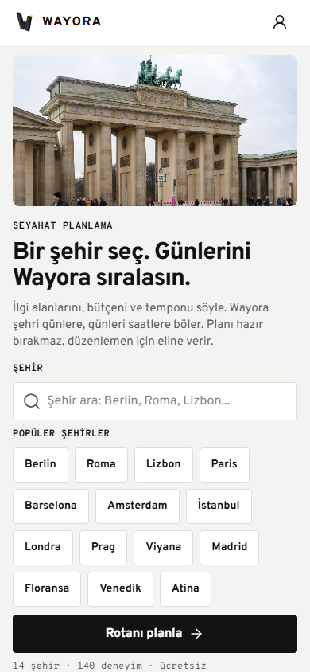
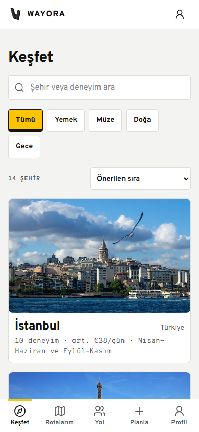
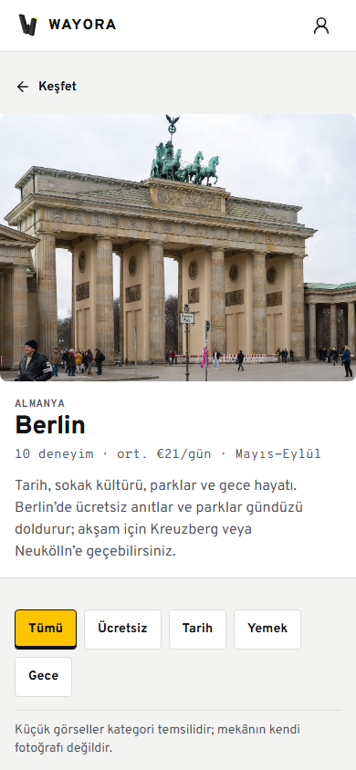
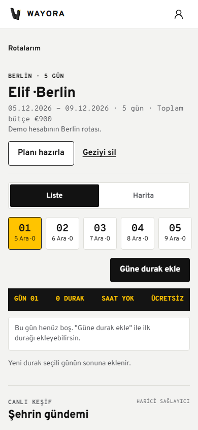
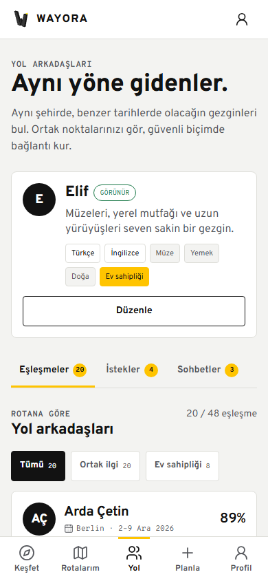
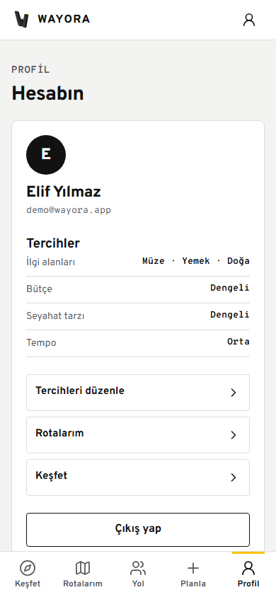
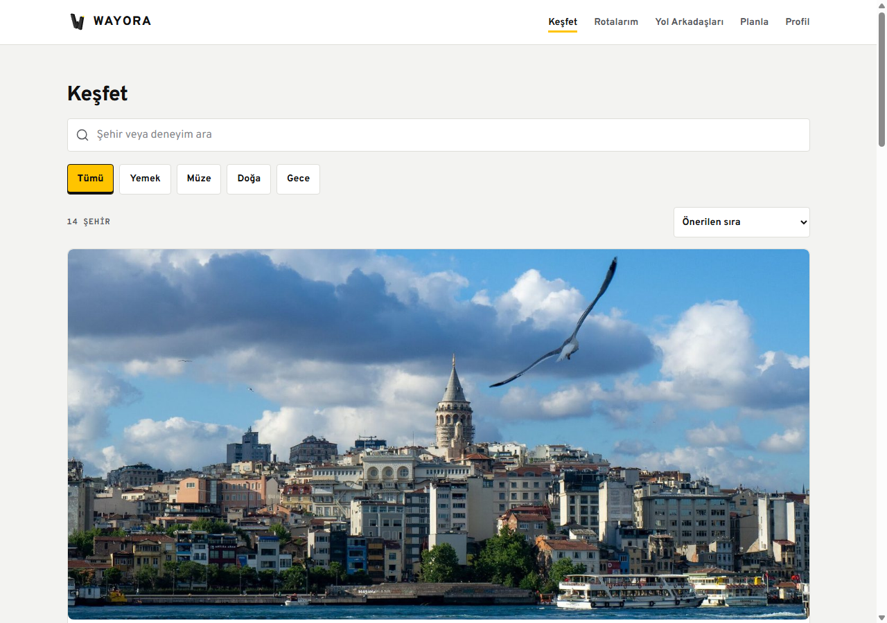

# Tasarım Tezi

Wayora bir “form doldurma” ürünü gibi değil, **şehirde karar veren bir seyahat defteri** gibi
hissettirmeli. Bunun için üç ilke kullanıldı:

1. **Fotoğraf karar verdirir.** Şehir ve deneyim kartlarında gerçek, lisanslı görsel; üzerine metin bindirme, filtre veya dekoratif katman yok.
2. **Tek vurgu.** Sarı yalnızca seçili/aktif durumu gösterir; buton rengi veya süs değildir.
3. **Sakin yüzey.** Krem zemin, beyaz kart, 1 px çizgi; gölge yalnızca yükselen panelde.

# Görsel Sistem

| Token | Değer | Kullanım |
| :--- | :--- | :--- |
| Zemin | `#F3F3F1` | Sayfa |
| Yüzey | `#FFFFFF` | Kart, form, panel |
| Mürekkep | `#121212` | Metin, birincil buton |
| İkincil | `#55575C` | Meta, yardımcı metin |
| Çizgi | `#DEDED9` | 1 px ayraç |
| Sinyal | `#FFC400` | Aktif gün, seçim, uyum |
| Başarı | `#1D7A4A` | Görünür/başarı |
| Hata | `#B42318` | Silme/uyarı |

- Tipografi: **Overpass** başlık/gövde, **Overpass Mono** tarih/fiyat/etiket.
- Radius: kontrol **4 px**, yüzey **8 px**, bottom sheet **12 px**.
- Boşluk ölçeği: 4, 8, 12, 16, 24, 32, 48.
- Dokunma hedefi: en az **44 px**.
- Hareket: 120–260 ms; `prefers-reduced-motion` tümünü kapatır.

## Landing

- İlk ekranda fotoğraf, değer önerisi, arama ve “Rotanı planla” var.
- 14 şehir chip’i 44 px hedefle sarılır; mobilde taşma yok.
- Ücret/deneyim sayısı katalogla aynı: **14 şehir / 140 deneyim**.

## Keşfet

- Arama, kategori, sıralama ve sonuç sayısı tek ekranda.
- “Tümü” seçili durumu sarı zemin + siyah kenar; tik ikonuna bağımlı değil.
- Kartta şehir, ülke, deneyim sayısı, günlük ortalama ve sezon var.

## Şehir rehberi

- Hero fotoğraf; başlık ve meta fotoğrafın altında.
- Deneyim satırının tamamı tıklanabilir; ayrı küçük metin linkine bağımlı değil.
- Seçim yapıldığında sabit alt özet; seçim sayısı ve kişi başı toplam.

## Rota detayı

- Gün şeridi; aktif gün sarı, tarih ve durak sayısı görünür.
- Siyah pano yalnızca gün özeti için: **gün / durak / saat / ücret**.
- Liste–Harita segmenti 44 px; sıralama sürükle-bırak ve butonlarla.
- Sabit “Güne durak ekle” ana eylemi başparmak bölgesinde.

## Yol Arkadaşları

- Profil görünürlüğü ve güvenlik onayı tek kartta.
- **Tümü / Ortak ilgi / Ev sahipliği** filtreleri; “20 / 48 eşleşme” şeffaflığı.
- Kartta skor, ortak gün, ortak ilgi, hosting niyeti ve “Bağlantı iste”.
- Üstte 5 sekme: Keşfet, Rotalarım, **Yol**, Planla, Profil.

## Profil

- Kullanıcı adı/e-posta, ilgi alanları, bütçe, seyahat tarzı ve tempo.
- Tercihleri düzenle, rotalar, keşfet ve çıkış tek listede.
- E-posta yalnızca kendi hesabında görünür.

# Masaüstü

- Masaüstünde içerik 1120 px’e kadar genişler; mobil tek kolon korunur.
- Keşif kartı geniş ekranda büyük fotoğraf ve okunabilir meta gösterir.
- Sosyal eşleşmeler iki kolon; sohbet bottom sheet olarak açılır.

# İmza Etkileşimler

| Etkileşim | Davranış | Erişilebilirlik |
| :--- | :--- | :--- |
| Seçimden plana | Şehir seçimi URL’de taşınır; özet paneli seçimleri gösterir | `aria-pressed`, odak halkası |
| Gün şeridi | Aktif gün otomatik görünür; içerik `day-in` ile gelir | Klavye/buton, reduced-motion |
| Sürükle-bırak | Sıra anında görünür; API hatasında geri alınır | Butonlarla alternatif sıralama |
| Bottom sheet | Seçim/sohbet paneli; Escape ve odak tuzağı | `role=dialog`, `aria-modal` |
| Sosyal filtre | Ortak ilgi/ev sahipliği; sıfır sonuçta temizle | `aria-pressed`, sayaç |
| Sayfalama | “Daha fazla eşleşme göster”; toplam görünür | Yükleme durumu, disabled |

# Durum Tasarımı

- **Yükleniyor:** iskelet; layout kayması yok.
- **Boş:** neden + sonraki adım; sosyal boş durumda üç koşul.
- **Hata:** eyleme dönük Türkçe mesaj + tekrar dene.
- **Başarı:** kısa, görev odaklı notice.
- **Kısmi:** canlı keşif anahtarı yoksa sahte veri yok; yapılandırma notu.

# Responsive ve Erişilebilirlik

- 390 px mobil ve 1280 px masaüstü audit: **22/22 kontrol temiz**.
- Yatay taşma yok; 44 px altı hedef yok.
- Form etiketleri, ikon `aria-label`, görünür odak, alt metinler tam.
- Renk tek başına anlam taşımaz; seçili durum metin/çizgiyle de belirtilir.
- `prefers-reduced-motion` bilgi kaybı olmadan animasyonları kapatır.

# UI Audit Kanıtı

`docs/audit/apple-frontend-audit.json`:

| Kontrol | Sonuç |
| :--- | :--- |
| Runtime hatası | 0 |
| Network hatası | 0 |
| Yatay taşma | 0 |
| 44 px altı hedef | 0 |
| Eksik görsel alt metni | 0 |
| H1 / landmark | 1 / sayfa |

# Yapılmaması Gerekenler

- Sarı buton veya sarı metin.
- Gradyan, vinyet, gölge (bottom sheet hariç), emoji.
- Fotoğraf üzerine metin bindirme.
- Kartın tamamı tıklanırken ayrı küçük “detay” linki.
- Doğrulanmamış “canlı”, “rezervasyon var” veya “kullanıcı yorumu” iddiası.

# Bilinçli Sınırlar

- Google OAuth, gerçek şifre sıfırlama ve 2FA yok.
- Harita OSM embed; marker senkronizasyonu veya canlı trafik yok.
- Ev sahipliği yalnızca niyet bilgisi; adres/rezervasyon yok.
- Demo profilleri üretim seed’ine otomatik girmez.

# Revizyon

| Sürüm | Tarih | Not |
| :--- | :--- | :--- |
| 1.0 | 23 Ekim 2026 | V2 mobil tasarım sistemi |
| 2.0 | 30 Ekim 2026 | Sosyal ekran, 5 sekme, güncel ekran görüntüleri ve audit |
